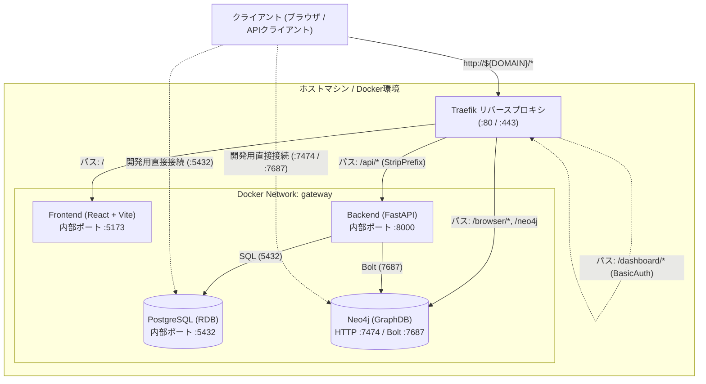

# システムアーキテクチャ概要

本書は、本リポジトリ（React + FastAPI + PostgreSQL + Neo4j + Traefik）が提供するシステムアーキテクチャの全体像、コンポーネント構成、および設計方針を定義するドキュメントです。
本テンプレートをもとに新規プロジェクトを開始する際は、本ドキュメントをベースに要件やシステム構成を更新してください。

---

## 1. 背景と設計方針 (Background & Design Policy)

### 1.1 本テンプレートの狙い
モダンなフルスタック Web アプリケーションにおいて、リレーショナルデータ（PostgreSQL）とグラフデータ（Neo4j）を併用するアーキテクチャを迅速に立ち上げるための基盤を提供します。

### 1.2 コア設計原則
1. **リバースプロキシによる単一オリジン化 (Traefik)**
   - フロントエンド、API、各種管理画面へのアクセスを Traefik 経由に統一し、CORS 問題の回避や本番環境での自動 TLS 証明書発行を容易にします。
2. **疎結合なコンテナ構成 (Multi-Compose)**
   - アプリケーション層（`frontend` / `backend`）、データ層（`db`）、プロキシ層（`proxy`）を用途ごとに分割し、独立した起動・停止・スケールを可能にしています。
3. **型安全性とモダンな開発体験**
   - フロントエンドは React + TypeScript + Vite、バックエンドは FastAPI + uv による高速な環境構築を採用しています。

---

## 2. システム全体構成図

システム全体のコンポーネント間連携およびネットワークルーティングは以下の通りです。



---

## 3. コンポーネント構成と技術スタック

### 3.1 サービス一覧

| サービス | 技術スタック | 役割 | ルーティング / ポート |
| :--- | :--- | :--- | :--- |
| **Proxy** | Traefik v3.6 | リバースプロキシ、ルーティング、SSL終端 | `http://${DOMAIN}/` (80, 443) |
| **Frontend** | React, TypeScript, Vite | ユーザーインターフェース | `http://${DOMAIN}/` (内部: 5173) |
| **Backend** | FastAPI, Python 3.12, uv | Web API、ビジネスロジック | `http://${DOMAIN}/api` (内部: 8000) |
| **RDB** | PostgreSQL 16+ | トランザクションデータ・リレーショナルデータ管理 | 内部: 5432, 外部公開: 5432 |
| **GraphDB** | Neo4j Community (APOC付) | 知識グラフ、ネットワーク構造データ管理 | Bolt: 7687, ブラウザ: `/browser` |

### 3.2 ディレクトリと Compose ファイルの責務

```text
.
├── compose.yaml          # アプリケーション層 (frontend, backend)
├── proxy/
│   └── compose.yaml      # プロキシ層 (traefik, letsencrypt)
├── db/
│   └── compose.yaml      # データベース層 (postgres, neo4j)
└── docs/                 # プロジェクトドキュメント
    ├── architecture.md   # 本書
    ├── roadmap.md        # 開発ロードマップ
    └── adr/              # 意思決定ログ (ADR)
```

---

## 4. ドキュメントの保守方針

- システム構成の変更（新しいマイクロサービスの追加、認証基盤の刷新、インフラ構成の移行等）を行った場合は、本ドキュメントの構成図およびサービス一覧を更新してください。
- 開発計画・フェーズ詳細・マイルストーンについては [roadmap.md](roadmap.md) を参照してください。
- アーキテクチャ上の重大な意思決定は [docs/adr/](adr/README.md) に Architecture Decision Records (ADR) として記録します。
