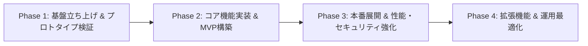

# 開発ロードマップ (Roadmap)

本書は、本テンプレートをベースとしたプロジェクトの開発フェーズ、マイルストーン、および将来の機能拡張計画を管理・追跡するためのドキュメントです。

---

## 1. プロジェクト理念と運用情報

- **プロジェクト名**: [プロジェクト名またはプロダクト名を記載]
- **リポジトリ**: [GitHub リポジトリURL 等]
- **主目標**: [本プロダクトが達成すべきコアバリューや目的を簡潔に記載]

---

## 2. フェーズ別全体像 (Overview)

---

## 3. 各フェーズの詳細とマイルストーン

### Phase 1: 基盤立ち上げ & プロトタイプ検証
- **目標**: 開発環境のセットアップ、基本通信（フロントエンド ⇔ バックエンド ⇔ DB）の疎通確認
- **主な実施項目**:
  - [x] Docker Compose 環境の構築（Traefik, Frontend, Backend, PostgreSQL, Neo4j）
  - [ ] データベーススキーマの初期設計（PostgreSQL マイグレーション、Neo4j ノード定義）
  - [ ] 主要 API エンドポイントのプロトタイプ実装
  - [ ] フロントエンド画面レイアウトと API 連携確認

### Phase 2: コア機能実装 & MVP (Minimum Viable Product)
- **目標**: エンドユーザーに提供するコア機能の実装と動作確認
- **主な実施項目**:
  - [ ] ユーザー認証・認可機能の実装
  - [ ] コアビジネスロジック・CRUD 処理の実装
  - [ ] グラフデータ探索・可視化機能の実装
  - [ ] 基本的なエラーハンドリングとバリデーション

### Phase 3: 本番展開 & 性能・セキュリティ強化
- **目標**: 本番サーバーへのデプロイ、SSL化、および負荷・セキュリティ対策
- **主な実施項目**:
  - [ ] 本番ドメイン取得と Let's Encrypt 自動 SSL 設定
  - [ ] CI/CD パイプライン（GitHub Actions 等）の構築
  - [ ] クエリ最適化、インデックスチューニング
  - [ ] バックアップ・リストア運用の確立

### Phase 4: 拡張機能 & 運用最適化
- **目標**: 運用フィードバックに基づく機能追加と監視運用の自動化
- **主な実施項目**:
  - [ ] ログ監視・メトリクス収集（Prometheus / Grafana 等の導入検討）
  - [ ] 外部サービス・API連携

---

## 4. 進捗・タスク管理方針

- **全体方針・マイルストーン**: 本ドキュメント (`docs/roadmap.md`) でフェーズごとの達成状況を管理します。
- **日々のタスク・Issue**: GitHub Projects および GitHub Issues にタスクをブレークダウンし、コミットやプルリクエストと連動させて進捗を追跡します。
- **設計方針の変更**: ロードマップの遂行に伴い設計判断が必要になった場合は、`docs/adr/` に ADR を起票して決定事項を記録します。
